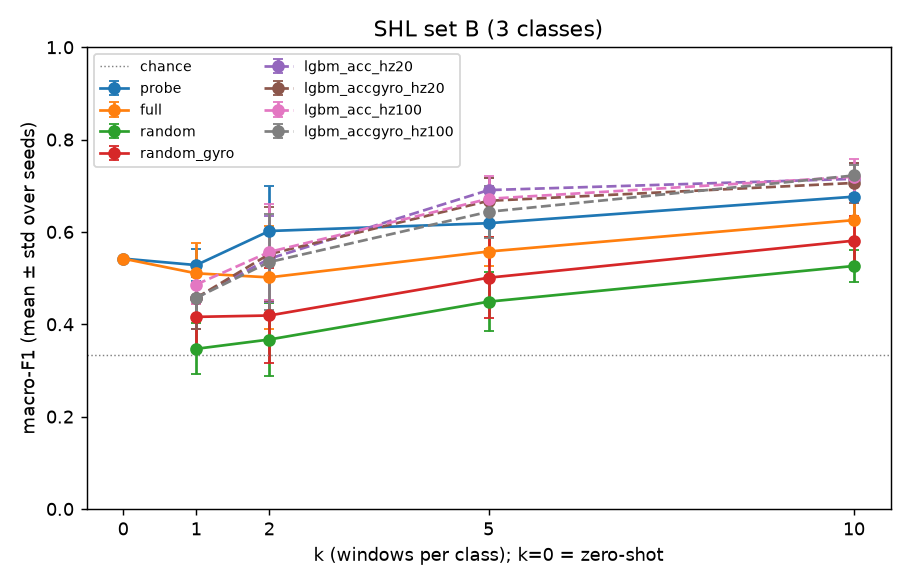

# Few-shot UniMTS vs random init vs LightGBM on SHL hips (User 1)

- Test: 73 days not in the pool, capped at 300 windows per SHL class (seed 0). Pool: days 190517 + 250517.
- k windows per class drawn from the pool per seed (make_kshot.py); every method uses the same windows.
- UniMTS: joint 1, wording w2, 20 Hz, 200 epochs, best training loss; probe/full use the released checkpoint, which is acc-only (--gyro 0); random is the same architecture from random init (acc only), random_gyro adds gyro (--gyro 1, 132 inputs). Fine-tuning ran on the Apple GPU (MPS); 5-epoch check vs CPU: same loss to 4 decimals, 99.7% identical predictions.
- k=0 is zero-shot (pretrained, text labels, no training).
- LightGBM: |acc| (and |gyro|) features, 20 Hz or 100 Hz copies of the same windows; lgbm_acc_hz20 is like-for-like with UniMTS.
- Split is by day for a single user, so all numbers are optimistic compared with new users.

## Conclusion

Pretrained UniMTS clearly beats the same architecture trained from random init. The linear probe was the best pretrained variant at every k in both sets. Paired by seed, it scores +0.15 to +0.24 macro-F1 above random in set B and +0.16 to +0.17 in set C. Adding gyro to random init (random_gyro) closes at most about a third of that gap, and none of it in set C at k=10. Full fine-tuning is worse than the probe everywhere, at 200 epochs on so few windows.

Against LightGBM on the same windows, pretraining helps only at the smallest k:

| Set | k | Probe minus lgbm_acc_hz20 | Seeds won by probe |
|---|---|---|---|
| B | 1 | +0.07 | 4/5 |
| B | 2 | +0.06 | 4/5 |
| B | 5 | −0.07 | 0/5 |
| B | 10 | −0.04 | 1/5 |
| C | 1 | +0.07 | 4/5 |
| C | 2 | +0.08 | 5/5 |
| C | 5 | +0.04 | 4/5 |
| C | 10 | 0.00 | 2/5 |

At k=10, the best LightGBM variants reach 0.72 in set B and 0.50–0.51 in set C, which matches or beats the probe.

The pretrained advantage comes from the motion classes: walk/run in B, and walk, run and bike in C. For example, in C at k=10 the probe recalls run 0.98 and bike 0.78. LightGBM gets 0.76 and 0.75 for those classes.

The pretrained model is weak exactly where we care most, on vehicles.

- **Probe:** it confuses vehicles with still and with each other. In C at k=10 its recall is car 0.30, bus 0.29, train 0.24 and subway 0.18.
- **LightGBM (C, k=10):** recall is car 0.36–0.40, bus 0.28–0.45, train 0.23–0.28 and subway 0.36–0.40.
- **Car windows in set B:** the share predicted as "vehicle" is 0.72 for the probe and 0.88 for full fine-tuning at k=10. For LightGBM it is 0.90–0.91.

Zero-shot (k=0) is a reasonable start only for still and walk/run. It reaches 0.54 in B and 0.30 in C, with vehicle recall of 0.25 in B and 0.00–0.12 per vehicle class in C.

These numbers have three limits:

- All results come from one user (SHL User 1), one placement (hips) and a split by day. Train and test therefore share the person, the phone and the routes, so every number is optimistic for new users.
- Each k uses only 5 seeds, and the paired standard deviations (0.01–0.10) are often as large as the differences against LightGBM.
- Probe and full fine-tuning use only the accelerometer, because the released checkpoint has no gyro weights.

Set A (still/walk/run) was evaluated zero-shot only. It was optional for few-shot and was not run.

## Set B

n_test per class: still 300, walk or run 600, vehicle 1500

| method | k | n_seeds | macro_f1 | rec_still | rec_walk or run | rec_vehicle |
|---|---|---|---|---|---|---|
| zeroshot | 0 | 1 | 0.542 ± 0.000 | 0.983 | 0.922 | 0.247 |
| probe | 1 | 5 | 0.528 ± 0.035 | 0.483 | 0.902 | 0.443 |
| probe | 2 | 5 | 0.602 ± 0.098 | 0.725 | 0.902 | 0.491 |
| probe | 5 | 5 | 0.619 ± 0.056 | 0.607 | 0.943 | 0.565 |
| probe | 10 | 5 | 0.676 ± 0.049 | 0.833 | 0.925 | 0.566 |
| full | 1 | 5 | 0.510 ± 0.066 | 0.346 | 0.960 | 0.441 |
| full | 2 | 5 | 0.502 ± 0.111 | 0.509 | 0.938 | 0.375 |
| full | 5 | 5 | 0.558 ± 0.031 | 0.314 | 0.952 | 0.546 |
| full | 10 | 5 | 0.626 ± 0.052 | 0.237 | 0.936 | 0.765 |
| random | 1 | 5 | 0.347 ± 0.055 | 0.212 | 0.960 | 0.219 |
| random | 2 | 5 | 0.367 ± 0.080 | 0.231 | 0.921 | 0.264 |
| random | 5 | 5 | 0.449 ± 0.065 | 0.219 | 0.916 | 0.422 |
| random | 10 | 5 | 0.526 ± 0.035 | 0.205 | 0.935 | 0.586 |
| random_gyro | 1 | 5 | 0.416 ± 0.067 | 0.403 | 0.934 | 0.250 |
| random_gyro | 2 | 5 | 0.419 ± 0.103 | 0.283 | 0.903 | 0.357 |
| random_gyro | 5 | 5 | 0.501 ± 0.088 | 0.271 | 0.937 | 0.483 |
| random_gyro | 10 | 5 | 0.581 ± 0.052 | 0.224 | 0.910 | 0.691 |
| lgbm_acc_hz20 | 1 | 5 | 0.457 ± 0.068 | 0.804 | 0.819 | 0.194 |
| lgbm_acc_hz20 | 2 | 5 | 0.542 ± 0.093 | 0.661 | 0.760 | 0.457 |
| lgbm_acc_hz20 | 5 | 5 | 0.691 ± 0.026 | 0.745 | 0.933 | 0.643 |
| lgbm_acc_hz20 | 10 | 5 | 0.715 ± 0.033 | 0.730 | 0.851 | 0.722 |
| lgbm_accgyro_hz20 | 1 | 5 | 0.457 ± 0.068 | 0.804 | 0.819 | 0.194 |
| lgbm_accgyro_hz20 | 2 | 5 | 0.552 ± 0.101 | 0.655 | 0.825 | 0.456 |
| lgbm_accgyro_hz20 | 5 | 5 | 0.667 ± 0.049 | 0.749 | 0.934 | 0.598 |
| lgbm_accgyro_hz20 | 10 | 5 | 0.706 ± 0.044 | 0.739 | 0.804 | 0.729 |
| lgbm_acc_hz100 | 1 | 5 | 0.486 ± 0.042 | 0.781 | 0.812 | 0.276 |
| lgbm_acc_hz100 | 2 | 5 | 0.557 ± 0.105 | 0.574 | 0.832 | 0.502 |
| lgbm_acc_hz100 | 5 | 5 | 0.672 ± 0.050 | 0.761 | 0.894 | 0.617 |
| lgbm_acc_hz100 | 10 | 5 | 0.719 ± 0.038 | 0.613 | 0.880 | 0.761 |
| lgbm_accgyro_hz100 | 1 | 5 | 0.457 ± 0.045 | 0.869 | 0.812 | 0.183 |
| lgbm_accgyro_hz100 | 2 | 5 | 0.535 ± 0.104 | 0.612 | 0.851 | 0.433 |
| lgbm_accgyro_hz100 | 5 | 5 | 0.644 ± 0.057 | 0.721 | 0.912 | 0.579 |
| lgbm_accgyro_hz100 | 10 | 5 | 0.722 ± 0.023 | 0.590 | 0.884 | 0.777 |

Best pretrained UniMTS minus each reference, macro-F1, paired by seed (mean ± std):

| k | best_pretrained | f1 | minus_random | minus_random_gyro | minus_lgbm_acc_hz20 | minus_lgbm_accgyro_hz100 |
|---|---|---|---|---|---|---|
| 1 | probe | 0.528 | +0.181 ± 0.032 (n=5) | +0.112 ± 0.068 (n=5) | +0.071 ± 0.096 (n=5) | +0.071 ± 0.071 (n=5) |
| 2 | probe | 0.602 | +0.235 ± 0.054 (n=5) | +0.183 ± 0.052 (n=5) | +0.060 ± 0.080 (n=5) | +0.067 ± 0.101 (n=5) |
| 5 | probe | 0.619 | +0.170 ± 0.089 (n=5) | +0.118 ± 0.082 (n=5) | -0.072 ± 0.038 (n=5) | -0.025 ± 0.057 (n=5) |
| 10 | probe | 0.676 | +0.150 ± 0.062 (n=5) | +0.095 ± 0.062 (n=5) | -0.039 ± 0.043 (n=5) | -0.046 ± 0.030 (n=5) |

Confusion matrix, set B, probe, k=10, seed 0 (rows true, cols predicted)

| index | still | walk or run | vehicle |
|---|---|---|---|
| true still | 278 | 0 | 22 |
| true walk or run | 21 | 557 | 22 |
| true vehicle | 600 | 55 | 845 |

Confusion matrix, set B, full, k=10, seed 0 (rows true, cols predicted)

| index | still | walk or run | vehicle |
|---|---|---|---|
| true still | 46 | 0 | 254 |
| true walk or run | 1 | 557 | 42 |
| true vehicle | 122 | 24 | 1354 |

Confusion matrix, set B, random, k=10, seed 0 (rows true, cols predicted)

| index | still | walk or run | vehicle |
|---|---|---|---|
| true still | 53 | 51 | 196 |
| true walk or run | 0 | 582 | 18 |
| true vehicle | 129 | 412 | 959 |

Confusion matrix, set B, random_gyro, k=10, seed 0 (rows true, cols predicted)

| index | still | walk or run | vehicle |
|---|---|---|---|
| true still | 73 | 0 | 227 |
| true walk or run | 0 | 517 | 83 |
| true vehicle | 172 | 119 | 1209 |

Confusion matrix, set B, lgbm_acc_hz20, k=10, seed 0 (rows true, cols predicted)

| index | still | walk or run | vehicle |
|---|---|---|---|
| true still | 237 | 0 | 63 |
| true walk or run | 8 | 420 | 172 |
| true vehicle | 404 | 64 | 1032 |

Confusion matrix, set B, lgbm_accgyro_hz20, k=10, seed 0 (rows true, cols predicted)

| index | still | walk or run | vehicle |
|---|---|---|---|
| true still | 261 | 0 | 39 |
| true walk or run | 12 | 421 | 167 |
| true vehicle | 326 | 65 | 1109 |

Confusion matrix, set B, lgbm_acc_hz100, k=10, seed 0 (rows true, cols predicted)

| index | still | walk or run | vehicle |
|---|---|---|---|
| true still | 154 | 0 | 146 |
| true walk or run | 2 | 494 | 104 |
| true vehicle | 159 | 63 | 1278 |

Confusion matrix, set B, lgbm_accgyro_hz100, k=10, seed 0 (rows true, cols predicted)

| index | still | walk or run | vehicle |
|---|---|---|---|
| true still | 135 | 0 | 165 |
| true walk or run | 3 | 494 | 103 |
| true vehicle | 126 | 63 | 1311 |

## Set C

n_test per class: still 300, walk 300, run 300, bike 300, car 300, bus 300, train 300, subway 300

| method | k | n_seeds | macro_f1 | rec_still | rec_walk | rec_run | rec_bike | rec_car | rec_bus | rec_train | rec_subway |
|---|---|---|---|---|---|---|---|---|---|---|---|
| zeroshot | 0 | 1 | 0.295 ± 0.000 | 0.923 | 0.230 | 0.967 | 0.413 | 0.120 | 0.083 | 0.010 | 0.000 |
| probe | 1 | 5 | 0.398 ± 0.026 | 0.309 | 0.772 | 0.874 | 0.373 | 0.343 | 0.128 | 0.239 | 0.245 |
| probe | 2 | 5 | 0.459 ± 0.036 | 0.359 | 0.775 | 0.954 | 0.726 | 0.395 | 0.241 | 0.185 | 0.141 |
| probe | 5 | 5 | 0.486 ± 0.029 | 0.453 | 0.749 | 0.964 | 0.825 | 0.317 | 0.308 | 0.227 | 0.135 |
| probe | 10 | 5 | 0.483 ± 0.018 | 0.419 | 0.815 | 0.976 | 0.783 | 0.301 | 0.293 | 0.237 | 0.183 |
| full | 1 | 5 | 0.385 ± 0.039 | 0.128 | 0.820 | 0.930 | 0.378 | 0.331 | 0.191 | 0.134 | 0.210 |
| full | 2 | 5 | 0.434 ± 0.023 | 0.169 | 0.812 | 0.934 | 0.711 | 0.321 | 0.239 | 0.143 | 0.143 |
| full | 5 | 5 | 0.438 ± 0.028 | 0.146 | 0.784 | 0.953 | 0.843 | 0.313 | 0.157 | 0.159 | 0.209 |
| full | 10 | 5 | 0.443 ± 0.051 | 0.162 | 0.842 | 0.883 | 0.797 | 0.252 | 0.243 | 0.155 | 0.263 |
| random | 1 | 5 | 0.241 ± 0.039 | 0.101 | 0.331 | 0.865 | 0.265 | 0.233 | 0.123 | 0.097 | 0.165 |
| random | 2 | 5 | 0.294 ± 0.029 | 0.127 | 0.591 | 0.883 | 0.270 | 0.209 | 0.220 | 0.120 | 0.105 |
| random | 5 | 5 | 0.318 ± 0.023 | 0.097 | 0.733 | 0.837 | 0.415 | 0.217 | 0.115 | 0.123 | 0.198 |
| random | 10 | 5 | 0.313 ± 0.027 | 0.137 | 0.601 | 0.729 | 0.471 | 0.189 | 0.169 | 0.135 | 0.203 |
| random_gyro | 1 | 5 | 0.281 ± 0.049 | 0.162 | 0.347 | 0.898 | 0.273 | 0.242 | 0.206 | 0.109 | 0.179 |
| random_gyro | 2 | 5 | 0.326 ± 0.031 | 0.163 | 0.637 | 0.827 | 0.371 | 0.240 | 0.241 | 0.119 | 0.135 |
| random_gyro | 5 | 5 | 0.331 ± 0.027 | 0.132 | 0.535 | 0.887 | 0.523 | 0.232 | 0.135 | 0.143 | 0.197 |
| random_gyro | 10 | 5 | 0.312 ± 0.039 | 0.137 | 0.619 | 0.643 | 0.430 | 0.210 | 0.250 | 0.127 | 0.203 |
| lgbm_acc_hz20 | 1 | 5 | 0.326 ± 0.046 | 0.576 | 0.669 | 0.622 | 0.167 | 0.235 | 0.124 | 0.203 | 0.152 |
| lgbm_acc_hz20 | 2 | 5 | 0.381 ± 0.038 | 0.385 | 0.410 | 0.663 | 0.600 | 0.281 | 0.219 | 0.274 | 0.200 |
| lgbm_acc_hz20 | 5 | 5 | 0.447 ± 0.046 | 0.497 | 0.534 | 0.817 | 0.649 | 0.381 | 0.213 | 0.206 | 0.308 |
| lgbm_acc_hz20 | 10 | 5 | 0.486 ± 0.016 | 0.483 | 0.647 | 0.764 | 0.753 | 0.361 | 0.284 | 0.229 | 0.362 |
| lgbm_accgyro_hz20 | 1 | 5 | 0.266 ± 0.068 | 0.617 | 0.545 | 0.397 | 0.239 | 0.179 | 0.096 | 0.194 | 0.052 |
| lgbm_accgyro_hz20 | 2 | 5 | 0.333 ± 0.057 | 0.367 | 0.352 | 0.523 | 0.575 | 0.299 | 0.237 | 0.179 | 0.198 |
| lgbm_accgyro_hz20 | 5 | 5 | 0.427 ± 0.037 | 0.443 | 0.577 | 0.821 | 0.562 | 0.313 | 0.211 | 0.252 | 0.251 |
| lgbm_accgyro_hz20 | 10 | 5 | 0.503 ± 0.018 | 0.512 | 0.669 | 0.764 | 0.727 | 0.395 | 0.349 | 0.261 | 0.357 |
| lgbm_acc_hz100 | 1 | 5 | 0.317 ± 0.060 | 0.609 | 0.501 | 0.623 | 0.236 | 0.309 | 0.094 | 0.197 | 0.103 |
| lgbm_acc_hz100 | 2 | 5 | 0.370 ± 0.060 | 0.350 | 0.406 | 0.570 | 0.608 | 0.243 | 0.227 | 0.247 | 0.298 |
| lgbm_acc_hz100 | 5 | 5 | 0.406 ± 0.041 | 0.388 | 0.438 | 0.718 | 0.642 | 0.265 | 0.293 | 0.242 | 0.281 |
| lgbm_acc_hz100 | 10 | 5 | 0.509 ± 0.028 | 0.523 | 0.644 | 0.761 | 0.727 | 0.351 | 0.451 | 0.227 | 0.397 |
| lgbm_accgyro_hz100 | 1 | 5 | 0.273 ± 0.023 | 0.635 | 0.469 | 0.347 | 0.275 | 0.266 | 0.091 | 0.177 | 0.084 |
| lgbm_accgyro_hz100 | 2 | 5 | 0.371 ± 0.048 | 0.355 | 0.351 | 0.679 | 0.515 | 0.261 | 0.243 | 0.246 | 0.300 |
| lgbm_accgyro_hz100 | 5 | 5 | 0.413 ± 0.048 | 0.426 | 0.501 | 0.718 | 0.623 | 0.284 | 0.264 | 0.261 | 0.280 |
| lgbm_accgyro_hz100 | 10 | 5 | 0.501 ± 0.030 | 0.535 | 0.656 | 0.761 | 0.677 | 0.309 | 0.412 | 0.278 | 0.387 |

Best pretrained UniMTS minus each reference, macro-F1, paired by seed (mean ± std):

| k | best_pretrained | f1 | minus_random | minus_random_gyro | minus_lgbm_acc_hz20 | minus_lgbm_accgyro_hz100 |
|---|---|---|---|---|---|---|
| 1 | probe | 0.398 | +0.157 ± 0.060 (n=5) | +0.117 ± 0.062 (n=5) | +0.072 ± 0.063 (n=5) | +0.125 ± 0.042 (n=5) |
| 2 | probe | 0.459 | +0.166 ± 0.047 (n=5) | +0.134 ± 0.032 (n=5) | +0.078 ± 0.047 (n=5) | +0.088 ± 0.022 (n=5) |
| 5 | probe | 0.486 | +0.169 ± 0.029 (n=5) | +0.155 ± 0.037 (n=5) | +0.039 ± 0.048 (n=5) | +0.073 ± 0.063 (n=5) |
| 10 | probe | 0.483 | +0.170 ± 0.036 (n=5) | +0.172 ± 0.027 (n=5) | -0.002 ± 0.011 (n=5) | -0.017 ± 0.029 (n=5) |

Confusion matrix, set C, probe, k=10, seed 0 (rows true, cols predicted)

| index | still | walk | run | bike | car | bus | train | subway |
|---|---|---|---|---|---|---|---|---|
| true still | 169 | 0 | 0 | 0 | 40 | 18 | 60 | 13 |
| true walk | 3 | 241 | 14 | 20 | 0 | 14 | 4 | 4 |
| true run | 0 | 2 | 293 | 4 | 0 | 1 | 0 | 0 |
| true bike | 2 | 6 | 2 | 259 | 10 | 20 | 0 | 1 |
| true car | 47 | 0 | 0 | 2 | 62 | 178 | 7 | 4 |
| true bus | 72 | 0 | 0 | 11 | 42 | 163 | 8 | 4 |
| true train | 109 | 0 | 0 | 3 | 49 | 106 | 30 | 3 |
| true subway | 112 | 0 | 0 | 1 | 39 | 109 | 29 | 10 |

Confusion matrix, set C, full, k=10, seed 0 (rows true, cols predicted)

| index | still | walk | run | bike | car | bus | train | subway |
|---|---|---|---|---|---|---|---|---|
| true still | 46 | 18 | 0 | 39 | 89 | 35 | 45 | 28 |
| true walk | 0 | 246 | 0 | 38 | 2 | 9 | 0 | 5 |
| true run | 0 | 2 | 153 | 144 | 0 | 1 | 0 | 0 |
| true bike | 1 | 16 | 0 | 262 | 15 | 1 | 0 | 5 |
| true car | 17 | 10 | 0 | 14 | 73 | 66 | 64 | 56 |
| true bus | 33 | 40 | 0 | 33 | 78 | 42 | 27 | 47 |
| true train | 47 | 24 | 0 | 25 | 79 | 55 | 34 | 36 |
| true subway | 31 | 32 | 0 | 39 | 61 | 41 | 47 | 49 |

Confusion matrix, set C, random, k=10, seed 0 (rows true, cols predicted)

| index | still | walk | run | bike | car | bus | train | subway |
|---|---|---|---|---|---|---|---|---|
| true still | 37 | 22 | 0 | 65 | 64 | 33 | 46 | 33 |
| true walk | 0 | 48 | 1 | 216 | 0 | 17 | 0 | 18 |
| true run | 0 | 46 | 188 | 64 | 0 | 1 | 0 | 1 |
| true bike | 2 | 30 | 10 | 226 | 7 | 14 | 2 | 9 |
| true car | 28 | 12 | 0 | 33 | 61 | 46 | 71 | 49 |
| true bus | 10 | 31 | 0 | 75 | 56 | 37 | 33 | 58 |
| true train | 30 | 23 | 0 | 63 | 57 | 54 | 25 | 48 |
| true subway | 27 | 16 | 0 | 52 | 51 | 43 | 42 | 69 |

Confusion matrix, set C, random_gyro, k=10, seed 0 (rows true, cols predicted)

| index | still | walk | run | bike | car | bus | train | subway |
|---|---|---|---|---|---|---|---|---|
| true still | 35 | 12 | 5 | 44 | 73 | 48 | 43 | 40 |
| true walk | 0 | 164 | 14 | 103 | 1 | 9 | 0 | 9 |
| true run | 0 | 71 | 224 | 4 | 0 | 1 | 0 | 0 |
| true bike | 1 | 109 | 2 | 151 | 22 | 5 | 0 | 10 |
| true car | 18 | 6 | 0 | 15 | 72 | 61 | 33 | 95 |
| true bus | 9 | 21 | 1 | 30 | 73 | 67 | 23 | 76 |
| true train | 28 | 7 | 5 | 28 | 69 | 82 | 26 | 55 |
| true subway | 22 | 2 | 0 | 38 | 59 | 52 | 44 | 83 |

Confusion matrix, set C, lgbm_acc_hz20, k=10, seed 0 (rows true, cols predicted)

| index | still | walk | run | bike | car | bus | train | subway |
|---|---|---|---|---|---|---|---|---|
| true still | 73 | 0 | 1 | 16 | 5 | 128 | 24 | 53 |
| true walk | 0 | 211 | 4 | 63 | 0 | 13 | 0 | 9 |
| true run | 0 | 28 | 213 | 59 | 0 | 0 | 0 | 0 |
| true bike | 0 | 51 | 3 | 224 | 1 | 21 | 0 | 0 |
| true car | 13 | 3 | 0 | 9 | 157 | 73 | 11 | 34 |
| true bus | 17 | 13 | 0 | 22 | 61 | 124 | 13 | 50 |
| true train | 20 | 14 | 0 | 14 | 16 | 65 | 34 | 137 |
| true subway | 25 | 5 | 0 | 16 | 11 | 89 | 30 | 124 |

Confusion matrix, set C, lgbm_accgyro_hz20, k=10, seed 0 (rows true, cols predicted)

| index | still | walk | run | bike | car | bus | train | subway |
|---|---|---|---|---|---|---|---|---|
| true still | 65 | 1 | 0 | 7 | 6 | 125 | 39 | 57 |
| true walk | 0 | 204 | 4 | 80 | 0 | 5 | 0 | 7 |
| true run | 0 | 39 | 213 | 48 | 0 | 0 | 0 | 0 |
| true bike | 1 | 22 | 3 | 262 | 3 | 9 | 0 | 0 |
| true car | 10 | 0 | 0 | 4 | 174 | 68 | 13 | 31 |
| true bus | 9 | 2 | 0 | 27 | 65 | 125 | 19 | 53 |
| true train | 15 | 5 | 1 | 13 | 25 | 75 | 48 | 118 |
| true subway | 23 | 3 | 0 | 24 | 19 | 103 | 37 | 91 |

Confusion matrix, set C, lgbm_acc_hz100, k=10, seed 0 (rows true, cols predicted)

| index | still | walk | run | bike | car | bus | train | subway |
|---|---|---|---|---|---|---|---|---|
| true still | 77 | 1 | 0 | 9 | 2 | 90 | 32 | 89 |
| true walk | 0 | 205 | 5 | 67 | 1 | 15 | 0 | 7 |
| true run | 0 | 76 | 219 | 5 | 0 | 0 | 0 | 0 |
| true bike | 0 | 59 | 3 | 216 | 7 | 15 | 0 | 0 |
| true car | 9 | 0 | 0 | 1 | 139 | 102 | 14 | 35 |
| true bus | 8 | 1 | 0 | 4 | 73 | 166 | 7 | 41 |
| true train | 19 | 0 | 0 | 4 | 23 | 137 | 29 | 88 |
| true subway | 28 | 1 | 0 | 3 | 18 | 139 | 24 | 87 |

Confusion matrix, set C, lgbm_accgyro_hz100, k=10, seed 0 (rows true, cols predicted)

| index | still | walk | run | bike | car | bus | train | subway |
|---|---|---|---|---|---|---|---|---|
| true still | 76 | 1 | 0 | 13 | 17 | 75 | 43 | 75 |
| true walk | 3 | 199 | 5 | 83 | 0 | 6 | 0 | 4 |
| true run | 0 | 76 | 219 | 4 | 1 | 0 | 0 | 0 |
| true bike | 1 | 59 | 3 | 228 | 0 | 8 | 0 | 1 |
| true car | 11 | 2 | 0 | 8 | 125 | 104 | 9 | 41 |
| true bus | 6 | 2 | 0 | 34 | 66 | 143 | 8 | 41 |
| true train | 14 | 0 | 0 | 10 | 32 | 90 | 90 | 64 |
| true subway | 28 | 1 | 0 | 22 | 25 | 109 | 51 | 64 |
