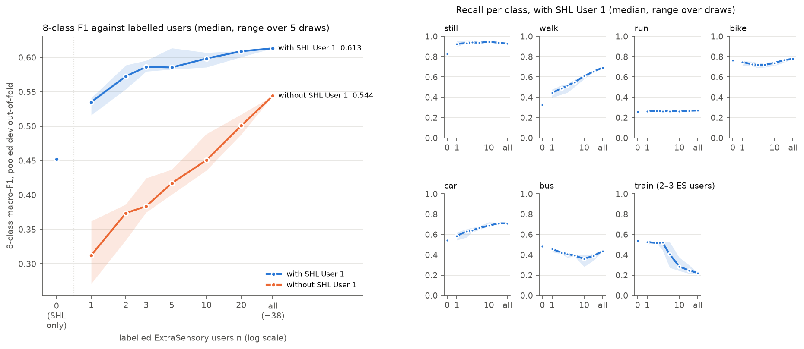

# 07 User label curve on waiis_bench_v1 (06's final configuration)

## Question

How does 06's final configuration improve with the number of labelled users? Where does the curve flatten, and which
classes are still gaining at the end? The answer decides whether more labelled people or a better model is the next
priority, and roughly how many WAIIS labellers per mode to plan for.

## Plan

*Approved 2026-10-30 with changes (stop-point 1); the changes are worked into this Plan.*

### Scope

- **Model:** 06's final configuration, settings unchanged:
  - acc model: 05's B (580 features, `tmd.acc_features`), LightGBM lr 0.1;
  - GPS model: gps-v2 (13 features, `tmd.gps_features`), LightGBM lr 0.02, trained on GPS-covered official minutes;
  - balanced class weights for both (`tmd.lgbm`), source weight 1 for SHL;
  - product fusion on GPS-covered minutes, acc model alone elsewhere (`pipe.product` of 06);
  - HMM forward-backward per session (`tmd.minutes`), transitions and initial distribution from the labelled minutes
    of the training users (before caps and drops).
- **Development data only.** The 12 ExtraSensory test users and SHL Users 2–3 are not read. No test stop-point.
- **Primary score:** pooled out-of-fold ExtraSensory dev 8-class macro-F1 over 7 classes (no subway); secondary:
  family macro-F1 over 5 families.
- **Two curves:**
  - **main:** SHL User 1 always in training (the public base); only the number of ExtraSensory users varies;
  - **no-SHL:** the same draws without SHL User 1 (both models and the HMM).

### Draw scheme

- Outer dev folds k = 0–4 (`experiments/04_frozen-benchmark_es-shl/splits/es_users_v2.csv`; 9, 10, 10, 10, 8 users).
- **Pool of fold k:** the ExtraSensory dev users of the other 4 folds: 38, 37, 37, 37, 39 users.
- **n ∈ {1, 2, 3, 5, 10, 20, all}**, and on the main curve **n = 0** (SHL User 1 only) as its first point.
- **Draw d (seeds 0–4):** one random ordering of each fold's pool (`numpy.random.default_rng([d, k]).permutation`
  of the sorted pool); n takes the first n users, so the training sets are nested within a draw.
  - The orderings are this experiment's split file, `splits/draws.json` (written by `draws.py`; it refuses to
    change once written). It gets an entry in `tracking.SPLITS`.
  - At **n = 0 and n = all**, one run each (draw 0, LightGBM seed 0).
- **SHL User 1 (main curve):** the SHL days of folds ≠ k, as in 06's paired folds (fold k's SHL days are not used,
  though SHL isn't scored here).
- Both models and the HMM transitions use the same n users (+ SHL User 1). The GPS model uses their GPS-covered
  official minutes.
- **LightGBM seed = draw seed** (bagging, feature fraction).

### Number of trees

- **Fixed at the final 06 models' rounds** (the median over 06's three test-model seeds):
  - acc model: **47** rounds at lr 0.1 (05's `test_B_seed{0,1,2}`: 47, 46, 48);
  - GPS model: **138** rounds at lr 0.02 (`test_G_v2_seed{0,1,2}`: 139, 136, 138).
- No early stopping, so no hidden labelled validation set.
- At n = all this is 06's H1_v2 with fixed rounds instead of per-fold early stopping. Its score is compared with
  H1_v2 seed 0 (0.613) as a sanity check.

**Early-stopping check (main curve, n = 2 and n = 10; reported, not adopted):**
- validation set: users n + 1 … n + 5 of the same ordering (5 extra users; the GPS model on their covered minutes);
- 06's early-stopping settings: patience 30 / at most 1,000 rounds (acc, lr 0.1), 150 / 10,000 (GPS, lr 0.02);
- the early-stopped models are scored directly (no refit: training data are the same n users);
- reported: rounds per model, and the paired difference per draw in pooled 8-class and family F1 against the
  fixed-rounds run with the same (n, draw), median and range over the 5 draws.

### Scoring

- For each (curve, n, draw), fold k's users are scored with that fold's models; the out-of-fold predictions are
  pooled over the 5 folds (as in 05/06). Per-fold scores only as spread.
- One MLflow run per (curve, n, draw): main 32, no-SHL 31, early-stopping check 10 = **73 runs**.
- **User-bootstrap 95% CIs** (`tmd.evaluate.bootstrap_users_recall`, redraws) **only at n = 0 and n = all**;
  elsewhere the spread over the 5 draws is the uncertainty (a deviation from CLAUDE.md, approved; see Results).
- Per run: 8-class and family macro-F1, before and after the HMM; per-class recall and F1; per-fold F1 min / max; iPhone and Android F1 (descriptive); covered / uncovered split;
  confusion matrices; model sizes; rounds; training minutes per class and iPhone share of the drawn users; classes
  absent from the training users.
- **Inference time** (single window and per window over 200 fold-0 sessions, as in 06): once per n, draw 0, fold-0
  models (main curve). Model size per run.

### Report

- **Per n:** 8-class (primary) and family F1, median and range over draws; with and without SHL.
- **Per n:** recall per class (all 7; still, walk, car, bus and train first), median and range.
- **Per n:** labelled minutes per class, platform mix, and the classes absent from the training users (Results,
  stop-point 1 has the dry run).
- **Gain per doubling** (fixed before running):
  - local gain between consecutive grid points: g_i = (F1(n_{i+1}) − F1(n_i)) / log2(n_{i+1} / n_i), computed per
    draw (the draws are nested, so the differences are paired), then the median over draws. For n = all,
    n = the fold's pool size, averaged over folds (37.6);
  - **the curve flattens at the first n_i whose median g_i < 0.01** (8-class). If no step is below 0.01, it has not
    flattened within the dev pool;
  - n = 0 has no log2 n: it is shown on the figure but is not part of the gain per doubling or the slope;
  - also the least-squares slope of F1 against log2 n over the grid points n ≥ 1, per draw, median and range;
  - **a class is still gaining at the end** if its median recall gain per doubling over the last step (20 → all) is
    ≥ 0.01.
- **One figure, two panels:** (left) 8-class F1 against n (log axis), with and without SHL User 1, median and range;
  (right) per-class recall against n, main curve.
- **Limits** (in the Conclusion): rail comes almost entirely from SHL User 1 (2–3 ExtraSensory train users in a fold's
  pool), so the rail curve can't be measured; ExtraSensory users are not WAIIS employees; a fold's pool is 37–39
  users, so the curve stops at ~38.

### Number of fits and run time

| part | runs | LightGBM fits |
|---|---|---|
| main curve: n = 0, 6 n × 5 draws, all; × 5 folds × 2 models | 32 | 320 |
| no-SHL curve: same | 31 | 310 |
| early-stopping check: 2 n × 5 draws × 5 folds × 2 models | 10 | 100 |
| **total** | **73** | **730** |

Estimate, from 06 / 05 fit times (acc ~12 s per fit on all dev data at ~50 rounds, GPS ~5 s; fits shrink with n):
- training: ~25 min per curve, ~10 min for the early-stopping check;
- evaluation (HMM over all dev minutes, user-bootstrap CIs) ~1 min per run, ~70 min; latency ~5 min;
- **total ~2–2.5 h**, in the background, with `tmd.progress` (units: model fits + one evaluation per run).

### Stop-points

1. ~~Plan~~: approved 2026-10-30 with changes.
2. Results, the figure, a draft Conclusion; update STATUS.md.

## Results

### Stop-point 1: dry run (2026-10-30)

```
uv run python draws.py        # splits/draws.json, results/coverage_dry_run.csv; logs/draws.log
```

No training. Training rows are official ExtraSensory dev minutes of the n drawn users (SHL User 1 is added on the main
curve: 23,076 official minutes over 5 day folds, all 8 classes). Each cell: median [min–max] over 5 draws × 5 folds
(n = all: 5 folds).

**Official minutes per class among the n users:**

| n | iPhone share | still | walk | run | bike | car | bus | train |
|---|---|---|---|---|---|---|---|---|
| 1 | 0.00 [0–1] | 1,620 [167–3,819] | 300 [2–707] | 0 [0–283] | 0 [0–456] | 115 [0–1,011] | 0 [0–307] | 0 [0–97] |
| 2 | 0.50 [0–1] | 3,227 | 504 | 2 [0–283] | 2 [0–469] | 360 [0–1,421] | 35 [0–307] | 0 [0–97] |
| 3 | 0.67 [0.33–1] | 5,532 | 712 | 2 [0–296] | 99 [0–584] | 479 [157–1,463] | 43 [0–307] | 0 [0–97] |
| 5 | 0.60 [0.20–1] | 10,579 | 1,350 | 8 [1–297] | 120 [0–1,101] | 889 [233–1,687] | 97 [2–531] | 0 [0–97] |
| 10 | 0.60 [0.20–0.90] | 19,904 | 2,682 | 30 [5–386] | 516 [121–1,337] | 2,083 [661–3,053] | 241 [91–609] | 0 [0–166] |
| 20 | 0.60 [0.40–0.80] | 38,677 | 5,366 | 142 [22–433] | 1,297 [478–2,165] | 3,690 [2,707–4,776] | 606 [316–926] | 93 [0–190] |
| all | 0.59 [0.59–0.61] | 75,647 | 10,611 | 434 [175–444] | 2,518 [2,226–2,776] | 6,434 [6,221–6,623] | 1,071 [937–1,174] | 166 [93–190] |

**Classes absent from the n users** (number of the 25 draw × fold training sets; n = all: of 5):

| n | run | bike | car | bus | train |
|---|---|---|---|---|---|
| 1 | 13 | 16 | 5 | 14 | 23 |
| 2 | 5 | 9 | 2 | 7 | 21 |
| 3 | 5 | 4 | 0 | 5 | 20 |
| 5 | 0 | 1 | 0 | 0 | 18 |
| 10 | 0 | 0 | 0 | 0 | 14 |
| 20 | 0 | 0 | 0 | 0 | 2 |
| all | 0 | 0 | 0 | 0 | 0 |

Still and walk are never absent. Subway never occurs in ExtraSensory.

**Users with the class among the n**, median [min–max]: at n = 10, run 4 [1–7], bike 4 [1–6], car 8 [5–10], bus 4
[2–7], train 0 [0–2]; at n = all, run 13, bike 14, car 30, bus 17, **train 2–3**.
GPS-covered minutes (the GPS model's ExtraSensory rows) are 71–96% of these counts per class (at n = all: run 0.71,
still and walk 0.80, bus 0.85, car 0.90, bike 0.92, train 0.95; `results/coverage_dry_run.csv`).

**What this means for the curve.**
- Below n = 5, the minority classes are often missing (run, bike, bus in roughly a third to two thirds of the
  training sets at n ≤ 2). The low end of the curve mixes "no examples" with "few examples"; the absent-class counts
  are reported with each point.
- On the main curve, SHL User 1 supplies every class at every n, so the no-SHL curve at small n shows mostly the
  missing classes.
- ExtraSensory train is absent from most training sets up to n = 10 and comes from 2–3 users at n = all: the
  ExtraSensory rail curve can't be measured, as expected.

**Approved 2026-10-30, with changes** (worked into the Plan):
1. n = 0 (SHL User 1 only) is the main curve's first point.
2. Fixed trees: the median of 06's three seeds (acc 47, GPS 138).
3. The Plan, `splits/draws.json` and the code are committed before the first run, so all runs are clean.
4. User-bootstrap CIs only at n = 0 and n = all.

**Deviation from CLAUDE.md (approved 2026-10-30):** CLAUDE.md asks for user-bootstrap 95% CIs with every
cross-validation result. Here they are computed only at n = 0 and n = all; for n = 1 … 20 the spread over the 5 draws
(median and range) is the reported uncertainty. Code: `curve.py`, `CI_AT`.

**Code** (committed before the first run):
- `curve.py`: one MLflow run per (curve, n, draw); out-of-fold probabilities per run in
  `<data>/processed/07_user-label-curve_waiis-bench/oof/<run>.npz`.
- `src/tmd/fusion.py`: 06's frame loader, product fusion and latency, moved to shared code for this experiment
  (06's `pipe.py` keeps its own copy, unchanged).
- `tracking.SPLITS`: `extrasensory_dev_v2_draws07` → `splits/draws.json`.

**Smoke test** (`uv run python curve.py --smoke`; fold 0 only, no MLflow):
- main n = 0: fold-0 8-class 0.396; no-SHL n = 1, draw 0: 0.217; early-stopping check n = 2, draw 0: 0.514
  (acc 19 rounds, GPS 87).
- **LightGBM stops on its own below the fixed rounds when a training set is tiny:** no-SHL n = 1, draw 3, fold 0
  (one user, 167 still + 2 walk minutes) ends at 43 acc / 1 GPS rounds, because no split meets
  min_child_samples = 50. This is 06's settings applied to very little data, not a change; the rounds actually
  trained are logged per run (`acc_rounds_*`, `gps_rounds_*`).

### Stop-point 2: results on development data (2026-10-30)

**Commands** (this folder; full output in `logs/`):

```
uv run python curve.py --curve main          # 32 runs; logs/stage_curve.out, logs/curve_main.log
uv run python curve.py --curve noshl         # 31 runs; logs/stage_curve{,2,3}.out, logs/curve_noshl.log
uv run python curve.py --curve escheck       # 10 runs; logs/stage_curve2.out, logs/curve_escheck.log
uv run python ../../src/tmd/tracking.py export 07_user-label-curve_waiis-bench   # results/runs.csv
uv run python tables.py                      # results/tables.md (the tables below), results/curve.png
```

**Runs.** 73 clean runs, one per (curve, n, draw):
- main (32) at `d55d057`;
- no-SHL: 2 at `d55d057`, 5 at `46c52af`, 24 at `bfc9a63`; early-stopping check (10) at `bfc9a63`.
- `curve.py` is the same in `46c52af` and `bfc9a63` (`bfc9a63` adds `tables.py` only).

**Deviations and incidents.**
1. **No GPS model when a fold has no GPS-covered training minutes** (`curve.py`, `point()`; committed as
   `46c52af`). Three dev users have no GPS-covered official minutes at all: 4E98F91F and 61359772 (Android),
   CDA3BBF7 (iPhone).
   - CDA3BBF7 is the only user of no-SHL, n = 1, draw 2, fold 0. LightGBM refused the empty GPS training set, and the
     chain stopped there (the failed run is in `runs.csv` without metrics).
   - That fold now uses the acc model alone, which is 06's fallback where there is no GPS. It is the only such fold
     in the experiment (`folds_without_gps_model`; on the main curve SHL User 1 always supplies GPS rows).
2. **Two no-SHL runs were first tagged dirty** (`noshl_n2_d2`, `noshl_n2_d3`): `tables.py` sat untracked in the
   tree while they ran. Both were rerun clean after the chain; the clean reruns are identical to the dirty ones (8-class
   0.387 and 0.365, family 0.487 and 0.497). Tables use the clean runs; the dirty ones stay in `runs.csv`.
3. **User-bootstrap CIs only at n = 0 and n = all** (approved deviation from CLAUDE.md, stop-point 1).
4. **LightGBM stops before the fixed rounds on tiny training sets** (smoke test, stop-point 1): only in no-SHL
   n = 1 (`acc_rounds_min`, `gps_rounds_min` in `runs.csv`). Not a change of settings.

**Sanity check.** n = all on the main curve (fixed rounds 47 / 138) scores 8-class **0.613**, family 0.686: the same as
06's H1_v2 seed 0 (0.613), which used early stopping per fold.

**Uncertainty.** The draw ranges show only the variation from *which users are trained on*. The user-bootstrap CIs
at n = 0 and n = all (scored users resampled) are much wider: 8-class 0.533–0.693 at n = all against a draw range of
0.601–0.610 at n = 20. Differences of ~0.01 between neighbouring n are well inside the evaluation uncertainty.

**Figure:** `results/curve.png`. Left: 8-class F1 against n, with and without SHL User 1 (median, range over draws);
right: recall per class against n, main curve.



**8-class and family macro-F1 per n** (pooled ExtraSensory dev out-of-fold; median [range] over 5 draws; n = 0 and n = all: one run, with the user-bootstrap 95% CI)

| n | 8-class, with SHL User 1 | 8-class, without | family, with | family, without | per-fold 8-class (with), min–max | 8-class before HMM (with) |
|---|---|---|---|---|---|---|
| 0 | 0.452 (0.365–0.545) | – | 0.502 (0.439–0.555) | – | 0.396–0.624 | 0.390 |
| 1 | 0.535 [0.516–0.541] | 0.312 [0.271–0.362] | 0.590 [0.570–0.602] | 0.441 [0.381–0.484] | 0.481–0.722 | 0.453 [0.425–0.458] |
| 2 | 0.573 [0.554–0.589] | 0.374 [0.335–0.387] | 0.618 [0.610–0.638] | 0.497 [0.477–0.521] | 0.495–0.755 | 0.476 [0.460–0.485] |
| 3 | 0.586 [0.580–0.596] | 0.384 [0.375–0.425] | 0.627 [0.620–0.642] | 0.522 [0.508–0.576] | 0.503–0.768 | 0.490 [0.481–0.495] |
| 5 | 0.585 [0.583–0.614] | 0.417 [0.401–0.437] | 0.631 [0.624–0.670] | 0.566 [0.545–0.576] | 0.501–0.785 | 0.498 [0.484–0.505] |
| 10 | 0.598 [0.586–0.607] | 0.451 [0.436–0.489] | 0.677 [0.659–0.687] | 0.610 [0.570–0.615] | 0.516–0.779 | 0.508 [0.503–0.509] |
| 20 | 0.609 [0.601–0.610] | 0.501 [0.488–0.517] | 0.678 [0.672–0.687] | 0.625 [0.622–0.628] | 0.537–0.798 | 0.509 [0.507–0.511] |
| all | 0.613 (0.533–0.693) | 0.544 (0.482–0.613) | 0.686 (0.622–0.729) | 0.626 (0.578–0.655) | 0.549–0.811 | 0.507 |

Per-fold: median over draws of the lowest and highest fold score (spread only).

**Gain per doubling, 8-class and family F1 — with SHL User 1** (median [range] over draws; n = all counted as 37.6 users)

| step | 8-class | family |
|---|---|---|
| 1 → 2 | 0.051 [0.019–0.070] | 0.029 [0.009–0.068] |
| 2 → 3 | 0.019 [0.012–0.044] | 0.015 [0.007–0.022] |
| 3 → 5 | 0.001 [-0.018–0.026] | 0.009 [-0.004–0.038] |
| 5 → 10 | 0.010 [-0.012–0.017] | 0.035 [0.017–0.051] |
| 10 → 20 | 0.010 [-0.006–0.016] | 0.009 [-0.009–0.014] |
| 20 → all | 0.005 [0.004–0.014] | 0.009 [-0.001–0.015] |

- Least-squares slope over n ≥ 1 per doubling: 8-class 0.014 [0.010–0.015], family 0.018 [0.018–0.021].
- **Flattens (8-class, rule fixed before running): n = 3**; family: n = 3.

**Gain per doubling, 8-class and family F1 — without SHL User 1** (median [range] over draws; n = all counted as 37.6 users)

| step | 8-class | family |
|---|---|---|
| 1 → 2 | 0.038 [0.025–0.094] | 0.043 [0.003–0.116] |
| 2 → 3 | 0.023 [0.017–0.083] | 0.036 [0.020–0.133] |
| 3 → 5 | 0.050 [-0.010–0.085] | 0.070 [-0.001–0.076] |
| 5 → 10 | 0.033 [0.020–0.055] | 0.037 [0.004–0.069] |
| 10 → 20 | 0.037 [0.028–0.079] | 0.014 [0.012–0.051] |
| 20 → all | 0.048 [0.030–0.062] | 0.001 [-0.002–0.005] |

- Least-squares slope over n ≥ 1 per doubling: 8-class 0.041 [0.035–0.049], family 0.035 [0.032–0.043].
- **Flattens (8-class, rule fixed before running): not within the dev pool**; family: n = 20.

**Recall per class — with SHL User 1** (median [range] over draws)

| n | still | walk | run | bike | car | bus | train |
|---|---|---|---|---|---|---|---|
| 0 | 0.82 | 0.33 | 0.26 | 0.76 | 0.54 | 0.48 | 0.54 |
| 1 | 0.93 [0.90–0.96] | 0.44 [0.40–0.48] | 0.26 [0.26–0.27] | 0.75 [0.71–0.76] | 0.59 [0.54–0.62] | 0.46 [0.43–0.47] | 0.53 [0.51–0.54] |
| 2 | 0.93 [0.93–0.96] | 0.49 [0.43–0.52] | 0.27 [0.26–0.27] | 0.72 [0.71–0.75] | 0.63 [0.57–0.65] | 0.42 [0.41–0.43] | 0.52 [0.51–0.52] |
| 3 | 0.94 [0.94–0.96] | 0.52 [0.45–0.53] | 0.26 [0.26–0.27] | 0.72 [0.69–0.74] | 0.64 [0.62–0.67] | 0.41 [0.37–0.41] | 0.52 [0.45–0.53] |
| 5 | 0.94 [0.93–0.96] | 0.55 [0.50–0.57] | 0.26 [0.26–0.27] | 0.72 [0.70–0.74] | 0.66 [0.65–0.68] | 0.39 [0.39–0.40] | 0.41 [0.27–0.53] |
| 10 | 0.95 [0.94–0.95] | 0.61 [0.58–0.62] | 0.26 [0.26–0.27] | 0.74 [0.71–0.75] | 0.69 [0.68–0.72] | 0.36 [0.28–0.40] | 0.28 [0.24–0.37] |
| 20 | 0.94 [0.93–0.94] | 0.65 [0.65–0.67] | 0.27 [0.27–0.27] | 0.77 [0.74–0.77] | 0.71 [0.70–0.72] | 0.39 [0.35–0.41] | 0.25 [0.22–0.30] |
| all | 0.93 | 0.69 | 0.27 | 0.78 | 0.71 | 0.44 | 0.22 |

**Recall per class — without SHL User 1** (median [range] over draws)

| n | still | walk | run | bike | car | bus | train |
|---|---|---|---|---|---|---|---|
| 1 | 0.95 [0.93–0.96] | 0.50 [0.43–0.62] | 0.01 [0.00–0.08] | 0.18 [0.00–0.36] | 0.48 [0.21–0.67] | 0.00 [0.00–0.14] | 0.00 [0.00–0.00] |
| 2 | 0.95 [0.94–0.96] | 0.55 [0.41–0.61] | 0.01 [0.00–0.17] | 0.25 [0.18–0.43] | 0.62 [0.29–0.71] | 0.09 [0.00–0.18] | 0.00 [0.00–0.00] |
| 3 | 0.95 [0.95–0.96] | 0.58 [0.42–0.61] | 0.01 [0.00–0.15] | 0.37 [0.20–0.46] | 0.71 [0.60–0.72] | 0.02 [0.00–0.10] | 0.00 [0.00–0.00] |
| 5 | 0.94 [0.93–0.95] | 0.63 [0.59–0.64] | 0.02 [0.00–0.14] | 0.47 [0.34–0.56] | 0.71 [0.69–0.72] | 0.04 [0.00–0.13] | 0.00 [0.00–0.00] |
| 10 | 0.93 [0.92–0.94] | 0.68 [0.66–0.69] | 0.06 [0.02–0.15] | 0.68 [0.41–0.72] | 0.72 [0.72–0.74] | 0.07 [0.01–0.14] | 0.00 [0.00–0.00] |
| 20 | 0.92 [0.92–0.92] | 0.71 [0.70–0.71] | 0.08 [0.05–0.17] | 0.76 [0.73–0.77] | 0.73 [0.73–0.74] | 0.17 [0.12–0.20] | 0.00 [0.00–0.00] |
| all | 0.91 | 0.72 | 0.19 | 0.78 | 0.73 | 0.33 | 0.00 |

**Recall gain per doubling over the last step (20 → all), main curve** (a class is still gaining if the median ≥ 0.01; F1 per class alongside)

| class | recall | class F1 |
|---|---|---|
| still | -0.009 [-0.010–-0.007] | -0.001 [-0.002–-0.000] |
| walk | 0.041 [0.027–0.043] **still gaining** | 0.003 [0.000–0.008] |
| run | 0.002 [0.000–0.005] | 0.004 [-0.001–0.005] |
| bike | 0.015 [0.009–0.040] **still gaining** | 0.008 [0.006–0.021] |
| car | -0.001 [-0.008–0.007] | 0.001 [0.001–0.005] |
| bus | 0.049 [0.027–0.099] **still gaining** | 0.027 [0.020–0.078] |
| train | -0.029 [-0.087–0.006] | -0.004 [-0.070–0.050] |

**Training data per n** (ExtraSensory official minutes per class, mean over folds; median over draws; absent = training sets without the class, of 5 folds × draws)

| n | iPhone share | still | walk | run | bike | car | bus | train | absent: run / bike / bus / train | folds without a GPS model (no-SHL) |
|---|---|---|---|---|---|---|---|---|---|---|
| 1 | 0.40 | 1,698 | 330 | 9 | 73 | 91 | 9 | 0 | 13 / 16 / 14 / 23 | 1 |
| 2 | 0.50 | 3,519 | 643 | 12 | 111 | 414 | 35 | 0 | 5 / 9 / 7 / 21 | 0 |
| 3 | 0.60 | 5,623 | 847 | 14 | 172 | 637 | 84 | 14 | 5 / 4 / 5 / 20 | 0 |
| 5 | 0.60 | 10,733 | 1,399 | 64 | 221 | 1,024 | 145 | 14 | 0 / 1 / 0 / 18 | 0 |
| 10 | 0.60 | 19,731 | 2,908 | 84 | 591 | 2,085 | 306 | 33 | 0 / 0 / 0 / 14 | 0 |
| 20 | 0.58 | 38,298 | 5,548 | 198 | 1,414 | 3,692 | 613 | 86 | 0 / 0 / 0 / 2 | 0 |
| all | 0.60 | 74,184 | 10,487 | 370 | 2,494 | 6,422 | 1,078 | 152 | 0 / 0 / 0 / 0 | 0 |

**Early-stopping check** (users n+1 … n+5 as validation; paired difference against the fixed-rounds run of the same draw; median [range] over 5 draws)

| n | Δ 8-class | Δ family | 8-class, early stopping | 8-class, fixed | acc rounds (fold mean) | GPS rounds (fold mean) |
|---|---|---|---|---|---|---|
| 2 | -0.018 [-0.029–-0.005] | -0.015 [-0.031–0.000] | 0.559 [0.544–0.568] | 0.573 [0.554–0.589] | 11 [7–15] | 44 [24–53] |
| 10 | -0.003 [-0.012–0.014] | -0.010 [-0.015–-0.001] | 0.596 [0.583–0.613] | 0.598 [0.586–0.607] | 12 [8–21] | 57 [45–89] |

**Cost** (main curve, draw 0, fold-0 models; single thread, after warm-up; model sizes mean over folds and draws)

| n | single window p50 / p95 ms | pipeline per window p50 / p95 ms | acc model MB | GPS model MB |
|---|---|---|---|---|
| 0 | 12.0 / 12.8 | 1.31 / 4.72 | 1.21 | 3.48 |
| 1 | 12.1 / 12.8 | 1.30 / 4.55 | 1.23 | 3.65 |
| 2 | 12.2 / 13.0 | 1.33 / 4.56 | 1.24 | 3.71 |
| 3 | 12.1 / 12.6 | 1.29 / 4.56 | 1.24 | 3.75 |
| 5 | 12.1 / 13.4 | 1.29 / 4.56 | 1.26 | 3.78 |
| 10 | 12.0 / 12.4 | 1.30 / 4.58 | 1.29 | 3.81 |
| 20 | 12.1 / 12.6 | 1.30 / 4.57 | 1.34 | 3.83 |
| all | 12.0 / 12.3 | 1.30 / 4.58 | 1.36 | 3.84 |

**Per-class F1, main curve** (medians over draws; `runs.csv`, `es_class_f1_<class>`), for reading the recall table:

| n | 0 | 1 | 2 | 3 | 5 | 10 | 20 | all |
|---|---|---|---|---|---|---|---|---|
| still | 0.865 | 0.916 | 0.923 | 0.925 | 0.926 | 0.937 | 0.936 | 0.935 |
| walk | 0.451 | 0.549 | 0.579 | 0.597 | 0.612 | 0.619 | 0.629 | 0.631 |
| run | 0.398 | 0.404 | 0.409 | 0.407 | 0.407 | 0.407 | 0.409 | 0.412 |
| bike | 0.524 | 0.718 | 0.776 | 0.791 | 0.802 | 0.826 | 0.837 | 0.844 |
| car | 0.629 | 0.661 | 0.683 | 0.692 | 0.701 | 0.709 | 0.723 | 0.724 |
| bus | 0.270 | 0.305 | 0.356 | 0.370 | 0.379 | 0.390 | 0.439 | 0.463 |
| train | 0.028 | 0.143 | 0.298 | 0.337 | 0.286 | 0.315 | 0.288 | 0.284 |

**Observations.**
- **Main curve:**
  - most of the gain comes with the first users: 0.452 (SHL User 1 only) → 0.535 (n = 1) → 0.586 (n = 3);
  - after that it gains about 0.01 per doubling: 0.586 (3) → 0.598 (10) → 0.613 (all);
  - **by the pre-set rule it flattens at n = 3** (3 → 5: +0.001 per doubling, range −0.018 to +0.026). The next
    steps are at the threshold (+0.010, +0.010) and the last is below it (+0.005). The overall slope over n ≥ 1 is
    +0.014 per doubling;
  - the family curve also flattens at n = 3 by the rule, but 5 → 10 gains +0.035;
  - before the HMM the 8-class curve stops gaining at n ≈ 10 (0.508, 0.509, 0.507).
- **No-SHL curve:**
  - far below the main curve at every n (0.312 at n = 1, 0.544 at n = all);
  - **not flattened within the dev pool**: +0.023 to +0.050 per doubling, +0.048 on the last step;
  - with all ~38 ExtraSensory users it scores 0.544, between the main curve's n = 1 (0.535) and n = 2 (0.573);
  - **train is never predicted** (recall and F1 0 at every n). Run recall stays ≤ 0.19, bus ≤ 0.33;
  - family F1 flattens at n = 20 (0.625 → 0.626).
- **Per class, main curve:**
  - **still:** recall 0.82 → 0.93 with the first user, then flat (0.93–0.95);
  - **walk:** recall rises steadily, 0.33 → 0.69, and is still gaining (+0.041 per doubling at the end). F1 gains much
    less at the end (+0.003): the extra walk recall comes with lower walk precision;
  - **run:** flat at 0.26–0.27 recall and 0.40–0.41 F1 from n = 0. ExtraSensory run users add nothing;
  - **bike:** F1 0.52 → 0.84; recall dips slightly to 0.72 at n = 2–5 and is gaining again at the end (+0.015);
  - **car:** recall 0.54 → 0.71, flat from n = 20;
  - **bus:** recall falls from 0.48 (n = 0) to 0.36 (n = 10), then rises to 0.44. **F1 rises at every step,
    0.27 → 0.46, and gains most at the end** (+0.027 per doubling for F1, +0.049 for recall);
  - **train:** recall falls 0.54 → 0.22 as ExtraSensory users are added, while train F1 rises 0.03 → 0.28–0.34. The
    ExtraSensory users mostly remove false rail; the scored train minutes come from 2–3 users.
  - **Still gaining at the end** (recall, last step ≥ 0.01): **walk, bike, bus.**
- **Early-stopping check:** early stopping on 5 extra users is **worse at n = 2** (−0.018 [−0.029, −0.005] 8-class,
  in all 5 draws) and **level at n = 10** (−0.003 [−0.012, +0.014]). It stops early (acc 11–12 rounds, GPS 44–57,
  against 47 / 138). Not adopted, as planned.
- **Training data:** the iPhone share is 0.40–0.60 per n (dev 0.60). The classes absent from the training users match
  the dry run (one row per n in the table above).
- **Cost** does not depend on n: ~12 ms per single window, ~1.3 ms per window over sessions; models 1.2–1.4 MB
  (acc) and 3.5–3.8 MB (GPS), growing slightly with n.

## Conclusion

**Draft — not approved.**

**Answer.** With SHL User 1 as the public base, 06's final configuration gains most from the first few labelled
ExtraSensory users, then about 0.01 8-class F1 per doubling (pooled dev out-of-fold, 5 draws):

| ExtraSensory users | 0 | 1 | 3 | 10 | all (~38) |
|---|---|---|---|---|---|
| 8-class F1, with SHL User 1 | 0.452 | 0.535 | 0.586 | 0.598 | 0.613 |
| 8-class F1, without | – | 0.312 | 0.384 | 0.451 | 0.544 |
| family F1, with SHL User 1 | 0.502 | 0.590 | 0.627 | 0.677 | 0.686 |

- **Where it flattens:** by the rule fixed before running, at **n = 3** (3 → 5: +0.001 per doubling). Later steps
  are at or below the 0.01 threshold (+0.010, +0.010, +0.005); the slope over n ≥ 1 is +0.014 per doubling.
  - Another doubling of this kind of user (~38 → ~76) would be worth roughly +0.005 to +0.014 8-class. That is small
    against the user-bootstrap CI at n = all (0.533–0.693).
- **Classes still gaining at the end:** walk (recall +0.041 per doubling), bike (+0.015) and **bus** (+0.049; bus F1
  +0.027, the largest F1 gain on the last step). Still, run and car have flattened; run hasn't moved from SHL User 1's
  level (0.26).
- **SHL User 1 is worth more than ~37 ExtraSensory users here:** without it, all ~38 users score 0.544, below the main
  curve at n = 2 (0.573). Without SHL train is never predicted, and the no-SHL curve hasn't flattened (+0.048 on the
  last step).

**For the priority question:**
- **More labelled people of the ExtraSensory kind are not the next priority for the overall score.** Past ~3 users
  on top of SHL User 1, each doubling adds ~0.01, inside the evaluation uncertainty. A better model, or data aimed at
  the weak classes, is the larger lever.
- **Labels still pay for bus, walk and bike.** Bus was still gaining at 17 bus users (~1,070 minutes), the most in the
  pool; walk and bike at ~37 and ~14 users.
- **Rough labeller numbers per mode (from ExtraSensory, not WAIIS):**
  - still: flat from the first user (~1,700 still minutes);
  - car: flat from n = 20, i.e. ~16 users with car (~3,700 car minutes);
  - run: ExtraSensory users add nothing over SHL User 1;
  - walk, bike: still gaining at ~37 and ~14 users with the mode;
  - bus: still gaining at ~17 users with the mode, so plan for more than 17;
  - rail: can't be measured (2–3 ExtraSensory train users; rail comes from SHL User 1).
- **The public base matters most:** SHL User 1 does more than any number of ExtraSensory users in the pool. Another
  public base, especially with rail and bus, is a candidate worth weighing against WAIIS labelling.

**Not adopted:** early stopping on 5 extra labelled users (n = 2: −0.018; n = 10: −0.003).

**Limits.**
- ExtraSensory users are not WAIIS employees, and their phones and app are from 2015. The WAIIS curve may differ,
  especially its starting point.
- The pool stops at ~38 users, so the curve beyond that is extrapolation.
- The draw ranges show training-user variation only. Evaluation-user uncertainty (bootstrap CIs) was computed only at
  n = 0 and n = all, where it is ±0.08.
- Rail: ExtraSensory train comes from 2–3 users, and train recall falls as they enter training while its F1 rises.
- The fixed rounds (47 / 138) come from models trained on all ~47 users; at small n they may not be the best choice
  (early stopping didn't help at n = 2 and n = 10).
- One fold (no-SHL, n = 1, draw 2) has no GPS model (Results, deviation 1).
