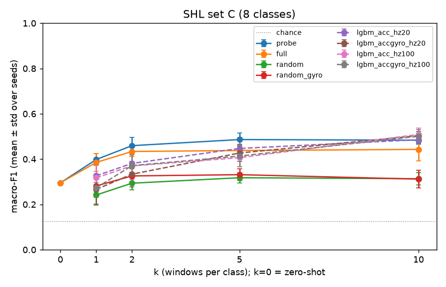

## Evaluating UniMTS on SHL Dataset

### Data: SHL user 1, hips (trouser front pocket)

- 91 recordings → 76 days (Mar–May 2017); excluded 160517 (no files), 180417 and 200317 (all Null).
- acc m/s² (median |acc| 9.99 when still), gyro rad/s, 100 Hz, 0 gaps, 0.071% NaN.
- Zero-phase FIR decimation 100 → 20 Hz per continuous stretch, then 10 s non-overlapping pure windows (single label, no
  Null/NaN/gap): (N, 200, 6), `--original_sampling_rate 20`. 100 Hz copy kept for LightGBM.
- ~139k pure windows (~390 h).
- Few-shot pool: 190517 + 250517. Test: other 73 days, 300 windows/class (seed 0).
- Class sets:
    - A: still / walk / run
    - B: still / foot (walk+run) / vehicle (bike+car+bus+train+subway)
    - C: all 8 classes

### 1. Zero-shot

- Joints 1/5 (L/R hip), 2/6 (L/R knee); short vs descriptive wording; chosen on pool → joint 1, descriptive.
- Hip > knee and descriptive > short for every joint (+0.03 to +0.06).
- Test macro-F1: A 0.94 | B 0.54 (vehicle recall 0.25) | C 0.30. Vehicles predicted as "standing still".

### 2. Few-shot

- k ∈ {1, 2, 5, 10}, seeds 0–4, drawn from pool; identical windows for all methods per (k, seed).
- UniMTS (joint 1, 200 epochs, batch 64, best epoch = lowest train loss, no validation; Apple GPU,
  checked against CPU):
    - `probe`: frozen encoder + linear head
    - `full`: encoder + head trained
    - `random`: same architecture, no pretraining (also with `--gyro 1`)
- LightGBM on |acc| (and |gyro|): mean, std, p10/50/90, zero crossings, Welch bands, dominant freq.
  Variants {acc, acc+gyro} × {20, 100 Hz}. Hyperparameters: see script.
- 160 UniMTS + 160 LightGBM runs, 0 failures.

**Macro-F1, mean of 5 seeds (k = 0: zero-shot)**

| Set | k  | probe | full | random | random+gyro | LGBM acc 20 Hz | best LGBM |
|-----|----|-------|------|--------|-------------|----------------|-----------|
| B   | 0  | 0.54  |      |        |             |                |           |
| B   | 1  | 0.53  | 0.51 | 0.35   | 0.42        | 0.46           | 0.49      |
| B   | 2  | 0.60  | 0.50 | 0.37   | 0.42        | 0.54           | 0.56      |
| B   | 5  | 0.62  | 0.56 | 0.45   | 0.50        | 0.69           | 0.69      |
| B   | 10 | 0.68  | 0.63 | 0.53   | 0.58        | 0.72           | 0.72      |
| C   | 0  | 0.30  |      |        |             |                |           |
| C   | 1  | 0.40  | 0.39 | 0.24   | 0.28        | 0.33           | 0.33      |
| C   | 2  | 0.46  | 0.43 | 0.29   | 0.33        | 0.38           | 0.38      |
| C   | 5  | 0.49  | 0.44 | 0.32   | 0.33        | 0.45           | 0.45      |
| C   | 10 | 0.48  | 0.44 | 0.31   | 0.31        | 0.49           | 0.51      |

Recall at C, k = 10:

- probe: run 0.98, bike 0.78, car 0.30, bus 0.29, train 0.24, subway 0.18
- LGBM: run 0.76, bike 0.75, car and subway 0.36–0.40

Set B, k = 10, car → vehicle: probe 72%, LGBM 90–91%. Seed std 0.01–0.10.

**Set C: Best model per k**

### 3. Findings

- Pretraining helps: probe > random by 0.15–0.24. Probe is the best UniMTS mode; `full` is always
  worse (likely overfitting; not tested).
- Probe beats LightGBM only with very few labels (B: k ≤ 2; C: k ≤ 5).
- Good at running and cycling; weak on vehicles, including car.
- Gyro and > 10 Hz add little to LightGBM at small k.

### 4. Decision

UniMTS is not adopted for vehicle detection; reference only. Also too large for the phone:
4.94M params ≈ 20 MB fp32 / 5 MB int8, against a 2 MB ceiling.

### 5. Limitations

One user, one phone position, split by day (optimistic). Accelerometer only, 20 Hz.
Few-shot regime only. Seed noise is comparable to some method gaps.

### Reproduce

`make_windows.py`, then `experiments/shl/.env-lgbm/bin/python experiments/shl/make_table.py`.
Commands in `experiments/shl/COMMANDS.md`, outputs in `experiments/shl/results/`.

### TODO

* unfreeze last layer only?
* analysis of data distribution profile of SHL vs UniMTS
* evaluate KPI + metrics (f1-score, inference time, model size)
